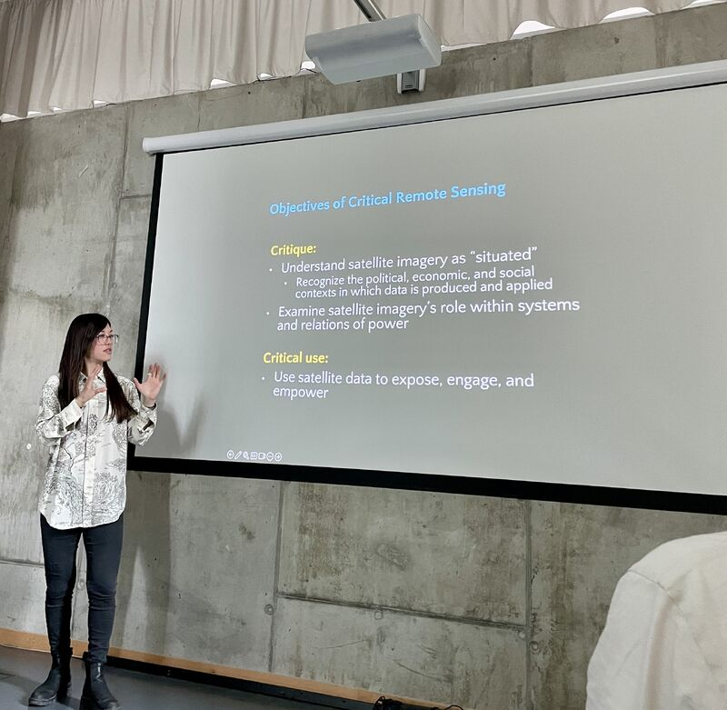

Pixel Politics: Who owns the satellites—and the stories they tell? Today we had the pleasure of welcoming Prof. Mia Bennett (University of Washington) to our EO Lab colloquium. Prof. Bennett explores the geopolitics of infrastructure at the planet's frontiers—from the Arctic to orbital space. Her work combines geospatial methods with critical and ethnographic approaches to reveal how technologies, power, and politics shape these spaces.

In her talk *Pixel Politics: Advancing Critical Remote Sensing*, she asked provocative questions: Who controls the satellites and their data? Who benefits—and who might be put at risk—when places are made visible? How can remote sensing move from exposure to true engagement and empowerment?

Her roadmap—Exposure → Engagement → Empowerment—invites us to rethink our own roles as scientists and to reflect on the politics of the pixels we analyze.

