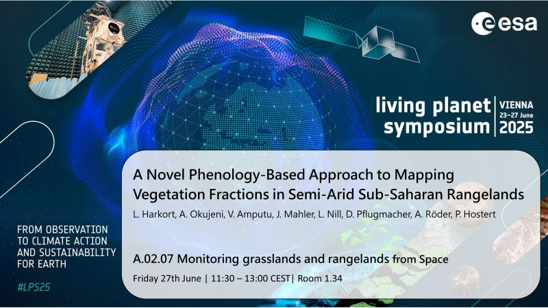

Excited to present at the Living Planet Symposium (LPS25) in Vienna on our novel phenology-based approach to mapping vegetation fractions in semi-arid Sub-Saharan rangelands. The framework helps characterize vegetation changes at landscape scale, including woody thickening and the impacts of extreme events on the resources people and animals depend on.

**A Novel Phenology-Based Approach to Mapping Vegetation Fractions in Semi-Arid Sub-Saharan Rangelands**
L. Harkort, A. Okujeni, V. Amputu, J. Mahler, L. Nill, D. Pflugmacher, A. Röder, P. Hostert

A.02.07 Monitoring grasslands and rangelands from Space — Friday 27th June, 11:30–13:00 CEST, Room 1.34

