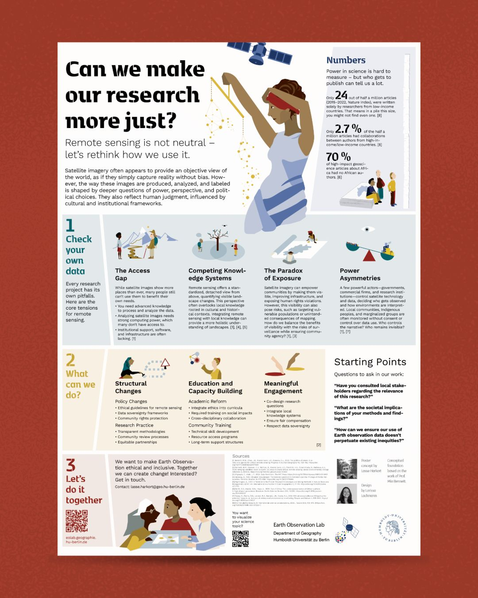

Proud to have contributed to this poster on Data Justice in Remote Sensing, designed and illustrated by [Larissa Lachmann](https://larissalachmann.de) and based on the work of [Prof. Mia Bennett](https://geography.washington.edu/people/mia-bennett).

Satellite imagery often appears neutral, but it isn't: decisions about who measures what, who controls the data, and who shapes the analysis all matter. The poster — an initial effort by the Earth Observation Lab at Humboldt-Universität zu Berlin — lays out where power imbalances show up in remote sensing research and offers concrete starting points for making our work more just, from checking our own data to structural change, education, and meaningful engagement with the communities we study.

