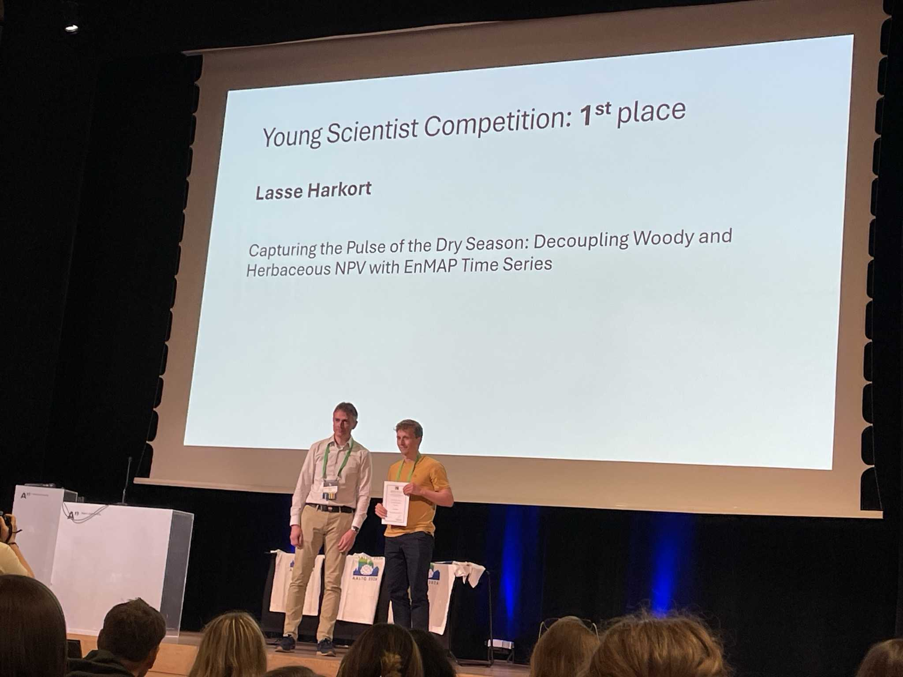

I am honored to have received the Young Scientists Award at the 14th EARSeL Workshop on Imaging Spectroscopy, hosted by Aalto University in Helsinki, Finland. Here I presented my recent research on "Capturing the Pulse of the Dry Season" showing how EnMAP hyperspectral data can be used to distinguish herbaceous from woody plant NPV types. I specifically want to thank my Co-Authors, the [Earth Observation lab](https://eolab.geographie.hu-berlin.de/) for their ongoing support and the Namibian Rangeland Farmers helping us to do the invaluable field work.

